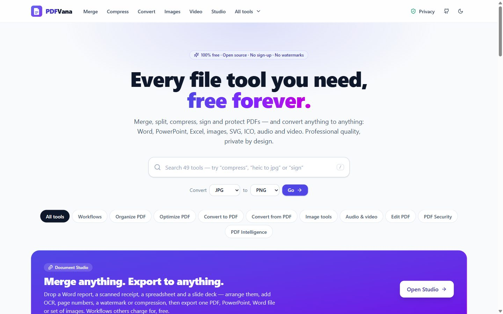
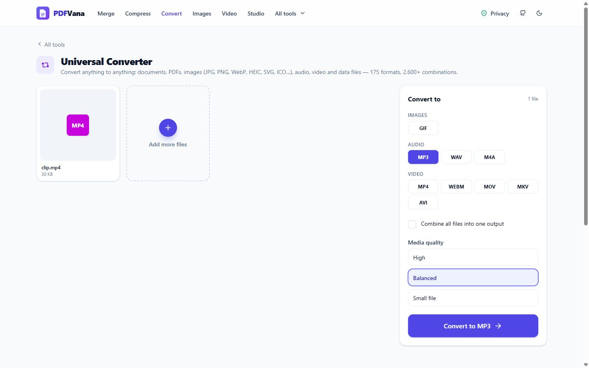

<div align="center">

<a href="https://github.com/divyakush2006/pdfvana"></a>

# PDFVana

### The open-source file platform: every PDF, document, image, audio and video tool in one private app

**A free, self-hosted alternative to iLovePDF, Smallpdf and CloudConvert.**<br/>
Merge, split, compress, convert, OCR, sign and protect, with no sign-up, no watermarks and no limits.

[](https://github.com/divyakush2006/pdfvana/releases)
[](LICENSE)
[](https://github.com/divyakush2006/pdfvana/actions/workflows/ci.yml)
[](https://github.com/divyakush2006/pdfvana/actions/workflows/codeql.yml)
[](https://scorecard.dev/viewer/?uri=github.com/Divyakush2006/pdfvana)
[](https://github.com/divyakush2006/pdfvana/pkgs/container/pdfvana)
[](https://github.com/divyakush2006/pdfvana/stargazers)

[**Quick start**](#-quick-start) · [**Features**](#-features) · [**For teams**](#-built-for-teams-and-enterprises) · [**Self-hosting**](#-deploy-to-production) · [**API**](#-rest-api) · [**Docs**](#-documentation) · [**FAQ**](#-faq)

<br/>

<picture>
  <source media="(prefers-color-scheme: dark)" srcset="docs/assets/home-dark.jpg" />
  <source media="(prefers-color-scheme: light)" srcset="docs/assets/home.jpg" />
  
</picture>

<sub><i>Vana (वन) is Sanskrit for "forest": a forest of free tools for every file.</i></sub>

</div>

<br/>

PDFVana brings the tools people use every day (PDF editing, Office conversion, image, audio and video conversion, OCR,
e-signatures and redaction) into **one fast web app that you run on your own infrastructure**. Documents never leave
your servers, every feature is free, and every tool is also available as a REST API.

## ✨ Key capabilities

- **Everything in one place.** 49 tools for PDFs, Office documents, images, audio, video and data, with 175 input
  formats and over 2,600 format combinations.
- **Workflows, not just tools.** *Document Studio* merges any mix of files and applies steps (compress, OCR, watermark,
  page numbers, password and more) in one pass, then exports to the format you need.
- **Office-grade fidelity.** Faithful Word, PowerPoint and Excel rendering; layout-aware PDF to Word, PowerPoint and
  Excel conversion; OCR in 28 languages, including Hindi, Bengali, Tamil and Telugu.
- **Private by design.** Files are processed on your hardware and deleted automatically. No accounts, tracking or
  telemetry, and it runs fully offline.
- **Secure by default.** Every job runs in an isolated, resource-limited process, behind read-only containers, with an
  automated attack test for every security control.
- **Built to integrate.** A REST API with OpenAPI docs for every tool, Docker images for amd64 and arm64, and a
  one-command production deployment with automatic HTTPS.

## ⚡ Quick start

**One command, no clone needed.** Requires [Docker](https://docs.docker.com/get-docker/) and about 4 GB of RAM.

```bash
curl -fsSL https://raw.githubusercontent.com/divyakush2006/pdfvana/main/docker-compose.yml -o docker-compose.yml
docker compose up -d
```

Then open **http://localhost:8080**. To build from source instead:

```bash
git clone https://github.com/divyakush2006/pdfvana.git && cd pdfvana
docker compose up -d --build
```

## ⚖️ How PDFVana compares

| | **PDFVana** | Typical freemium PDF sites |
|---|:---:|:---:|
| Price | **Free forever** | Free tier plus paid plans |
| Every tool available without an account | ✅ | Some tools premium-only |
| Tasks, files and pages | **Unlimited** (you set the limits) | Daily and size limits |
| Watermark-free output | ✅ | Varies |
| Multi-step workflows (merge, apply steps, export) | ✅ Document Studio | Premium |
| Images, audio, video and data in the same app | ✅ | Separate sites |
| Documents stay on your own servers | ✅ | ❌ |
| Open source and auditable | ✅ Apache-2.0 | ❌ |
| REST API | ✅ Free | Paid |
| Tracking and analytics | **None** | Common |

## 🧰 Features

**49 tools · 175 input formats · 2,600+ format combinations · 83 one-click conversion pages** such as
`/pdf-to-docx`, `/docx-to-pdf`, `/pptx-to-pdf`, `/heic-to-jpg` and `/mp4-to-mp3`.

| Category | What you can do |
|---|---|
| ⭐ **Workflows** | **Document Studio**: combine any files, apply compress, OCR, watermark, page numbers, header/footer, rotate, remove pages, grayscale, flatten, sanitize or password steps, and export to any format · **Universal Converter**: anything to anything |
| 📑 **Organize PDF** | Merge PDFs *and* Word, Excel, PowerPoint or image files · Split · Remove and extract pages · Visual organizer (drag, rotate, delete, insert blank pages) · Rotate |
| 🗜️ **Optimize PDF** | Compress (4 levels **or an exact target size**) · Repair · OCR in 28 languages · PDF/A archiving |
| 📥 **Convert to PDF** | Word, PowerPoint, Excel, Pages, Keynote, Numbers, OpenDocument, images (including HEIC and SVG), web pages, HTML, Markdown, EPUB, e-mail (EML), source code, CSV and JSON |
| 📤 **Convert from PDF** | Word (layout, tables and images kept) · Editable PowerPoint · Excel, CSV and JSON tables · JPG, PNG, WebP, TIFF · SVG · Text, Markdown, HTML, EPUB, ODT, RTF |
| 🖼️ **Images** | Convert JPG, PNG, WebP, AVIF, HEIC, GIF, BMP, TIFF, ICO and SVG · Compress to an **exact KB size** · Resize, rotate and flip · Vectorise PNG/JPG to SVG · Favicon generator · Remove photo metadata (EXIF and GPS) · Website screenshots |
| 🎬 **Audio & video** | Convert MP4, MOV, MKV, WebM and AVI (trim, resize, mute) · MP3, WAV, FLAC, M4A, OGG and Opus · Video to GIF · Compress video |
| ✏️ **Edit PDF** | Watermark (text in any script, or an image) · Page numbers · Header and footer · Sign (draw, type or upload, then drag to place) · Crop with auto-trim · Flatten · Edit metadata |
| 🔐 **Security** | Protect with AES-256 and permissions · Unlock · **True redaction** with automatic e-mail, phone, card, Aadhaar and PAN detection · Sanitize hidden data |
| 🧠 **Intelligence** | Compare two documents side by side · PDF to Markdown for AI and LLM tools |

<details>
<summary><b>See all 49 tools</b></summary>
<br/>

Document Studio · Universal Converter · Merge PDF · Split PDF · Remove Pages · Extract Pages · Organize PDF · Rotate PDF ·
Compress PDF · Repair PDF · OCR PDF · PDF to PDF/A · Word to PDF · PowerPoint to PDF · Excel to PDF · Image to PDF ·
HTML to PDF · Anything to PDF · CSV/Excel/JSON Converter · PDF to Word · PDF to PowerPoint · PDF to Excel · PDF to Image ·
PDF to Text · PDF to SVG · Image Converter · Compress Image · Resize & Rotate Image · Image to SVG · Favicon Generator ·
Remove Photo Metadata · Website Screenshot · Video Converter · Audio Converter · Video to GIF · Compress Video · Watermark ·
Page Numbers · Header & Footer · Sign PDF · Crop PDF · Flatten PDF · Edit Metadata · Protect PDF · Unlock PDF · Redact PDF ·
Sanitize PDF · Compare PDF · PDF to Markdown

</details>

## 📸 Screenshots

<table>
<tr>
<td width="50%"><p align="center"><b>Universal Converter</b><br/><sub>Only offers formats your files can actually become</sub></p></td>
<td width="50%"><p align="center"><b>Results</b><br/><sub>Download, preview, delete now or continue with another tool</sub></p></td>
</tr>
</table>

## 🏢 Built for teams and enterprises

| | |
|---|---|
| **Data residency** | Documents are processed and stored only on your servers and deleted automatically after a period you choose. Keeping files in-house simplifies compliance with data-protection rules such as GDPR and India's DPDP Act. |
| **Access control** | PDFVana has no user accounts to manage. Put it behind your existing single sign-on or identity-aware proxy to restrict it to your organisation. |
| **Integration** | Every tool is an HTTP endpoint with OpenAPI docs, ready for internal portals, back-office jobs and automation platforms. |
| **Scale** | One container handles a team; add CPU and workers for public traffic. Sizing guidance is in the [deployment guide](docs/deployment.md#sizing). |
| **Security assurance** | Process isolation, sandboxed converters, read-only containers and a documented [threat model](docs/security.md). Every dependency is pinned by hash, digest or commit, with continuous CodeQL, Trivy, pip-audit, npm audit and OpenSSF Scorecard scanning. |
| **Licensing** | Apache-2.0: commercial use, modification and redistribution allowed, with an explicit patent grant. No open-core, no paid tier. |

## 🌍 Deploy to production

A production stack with **automatic HTTPS** lives in [`deploy/`](deploy):

```bash
export DOMAIN=pdf.example.com          # DNS must point at your server
docker compose -f deploy/docker-compose.prod.yml up -d
```

Sizing, updates and SEO for public instances: [docs/deployment.md](docs/deployment.md).

## ⚙️ Configuration

| Variable | Default | Description |
|---|---|---|
| `SITE_URL` | `http://localhost:8080` | Public URL, used for canonical links, the sitemap and social cards |
| `JOB_TTL_SECONDS` | `3600` | Files are permanently deleted after this many seconds |
| `MAX_FILE_MB` / `MAX_TOTAL_MB` / `MAX_FILES` | `200` / `500` / `60` | Upload limits |
| `RATE_LIMIT_PER_MINUTE` | `40` | New jobs per client per minute |
| `API_RATE_LIMIT_PER_MINUTE` | `600` | All API requests per client per minute |
| `MAX_ACTIVE_JOBS_PER_CLIENT` | `4` | Jobs one client may run at once |
| `JOB_TIMEOUT_SECONDS` / `JOB_MEMORY_MB` | `900` / `3072` | Hard time and memory limit per job |
| `TRUST_PROXY` | `false` | Trust `X-Forwarded-For` (enable only behind your own reverse proxy) |
| `WORKERS` | CPU count | Jobs processed in parallel |

Every setting is documented in [`backend/app/config.py`](backend/app/config.py).

## 🔌 REST API

Every tool is available over HTTP, with interactive docs at `/api/docs`.

```bash
curl -F tool=compress-pdf -F 'options={"level":"recommended"}' -F files=@report.pdf http://localhost:8080/api/jobs   # → {"id": "…"}
curl http://localhost:8080/api/jobs/<id>                 # poll until "status": "done"
curl -OJ http://localhost:8080/api/jobs/<id>/download     # download the result
```

Tool ids, options and examples: [docs/api.md](docs/api.md).

## 🛡️ Security

PDFVana treats every upload as hostile:
- **Isolation.** Jobs run in separate processes with memory and time limits.
- **Validation.** Uploads are content-checked, HTML is sanitised and document converters run sandboxed.
- **Attack prevention.** SSRF, XSS, CSRF and argument injection are blocked.
- **Hardened deployment.** Containers run read-only with every Linux capability dropped.

Each control has an automated attack test.

→ [Security policy](SECURITY.md) · [Threat model](docs/security.md) · Report vulnerabilities privately through
[GitHub security advisories](https://github.com/divyakush2006/pdfvana/security/advisories/new).

## 🏗️ Architecture

```
Browser (React · TypeScript · Tailwind CSS · in-browser PDF previews)
   │  HTTPS: upload → job id → poll → download
   ▼
PDFVana engine (Python · FastAPI)                       Conversion service (internal only)
  • job queue · per-job process isolation      ───►     office documents & web pages → PDF
  • PDF engine: geometry, stamping, layout analysis,
    Word / PowerPoint / Excel / Markdown writers, redaction
  • image, audio/video & data converters · OCR · compression
  • server-rendered SEO pages · sitemap.xml
```

Details: [docs/architecture.md](docs/architecture.md).

## 📚 Documentation

| Guide | What it covers |
|---|---|
| [Deployment](docs/deployment.md) | Production setup with HTTPS, sizing, updates and SEO for public instances |
| [REST API](docs/api.md) | Endpoints, every tool id and its options, examples |
| [Architecture](docs/architecture.md) | How the engine, job queue and conversion service fit together |
| [Security](docs/security.md) | Threat model and the control behind each threat |
| [Contributing](CONTRIBUTING.md) | Local development, tests and project layout |
| [Changelog](CHANGELOG.md) | What changed in every release |

## 🗺️ Roadmap

- [x] 49 tools across PDF, documents, images, audio, video and data
- [x] Document Studio workflows and Universal Converter
- [x] REST API, multi-architecture Docker images and one-command HTTPS deployment
- [x] Per-job process isolation and a full security test suite
- [ ] In-browser PDF editor: add and edit text, shapes and annotations
- [ ] Fillable PDF forms: detect, create and fill
- [ ] Interface translations, starting with Hindi
- [ ] Installable app (PWA) and desktop builds
- [ ] Optional self-hosted AI: summarise, translate and chat with documents

Have an idea? [Request a feature](https://github.com/divyakush2006/pdfvana/issues/new?template=feature_request.yml) or
join the [discussions](https://github.com/divyakush2006/pdfvana/discussions).

## ❓ FAQ

<details>
<summary><b>Is PDFVana a free alternative to iLovePDF?</b></summary>
<br/>

Yes. PDFVana covers the everyday iLovePDF tools: merge, split, compress, PDF to and from Word, PowerPoint, Excel and JPG,
OCR, sign, watermark, page numbers, protect, unlock, redact, compare and PDF/A. It adds workflows, and it is free with no
task limits, watermarks or account.
</details>

<details>
<summary><b>Is it an open-source alternative to Smallpdf, Adobe Acrobat online or CloudConvert?</b></summary>
<br/>

Yes. Beyond PDF tools it converts documents, images (including HEIC, AVIF, SVG and ICO), audio and video: 175 input
formats in one self-hosted app, under the Apache-2.0 licence.
</details>

<details>
<summary><b>Are my files safe and private?</b></summary>
<br/>

When you self-host, files never leave your server. Inputs are deleted as soon as processing ends, and results after one
hour (or instantly with "Delete now"). Nothing survives a restart, and there is no tracking. See the
[threat model](docs/security.md).
</details>

<details>
<summary><b>Can I use it at work or in a commercial product?</b></summary>
<br/>

Yes. Apache-2.0 allows commercial use, modification and redistribution. Keep the licence and notice files.
</details>

<details>
<summary><b>Does it work offline or in an air-gapped network?</b></summary>
<br/>

Yes. Everything runs in two containers on your own hardware. Only "web page to PDF" and website screenshots need internet
access, to reach the page you ask for.
</details>

<details>
<summary><b>How does it compare with other self-hosted PDF tools?</b></summary>
<br/>

PDFVana has no paid tier and no telemetry, uses a permissive licence, and goes beyond PDFs with image, audio, video and
data conversion, a Universal Converter, Document Studio workflows and 83 ready-made conversion pages for public instances.
</details>

## 💬 Community and support

- **Questions and ideas:** [GitHub Discussions](https://github.com/divyakush2006/pdfvana/discussions)
- **Bug reports and feature requests:** [GitHub Issues](https://github.com/divyakush2006/pdfvana/issues/new/choose)
- **Security reports:** privately, as described in [SECURITY.md](SECURITY.md)

Feedback shapes the roadmap. If something is missing or could work better, please open an issue.

## ⭐ Support the project

If PDFVana saves you time or money, **[star the repository](https://github.com/divyakush2006/pdfvana/stargazers)**.
It is the simplest way to help others find a free, private alternative. Sharing it with your team or community helps too.

## 📄 License

PDFVana is released under the [Apache License 2.0](LICENSE).<br/>
Copyright © 2026 Divyakush ([@divyakush2006](https://github.com/divyakush2006)).

<div align="right"><a href="#pdfvana">↑ Back to top</a></div>
