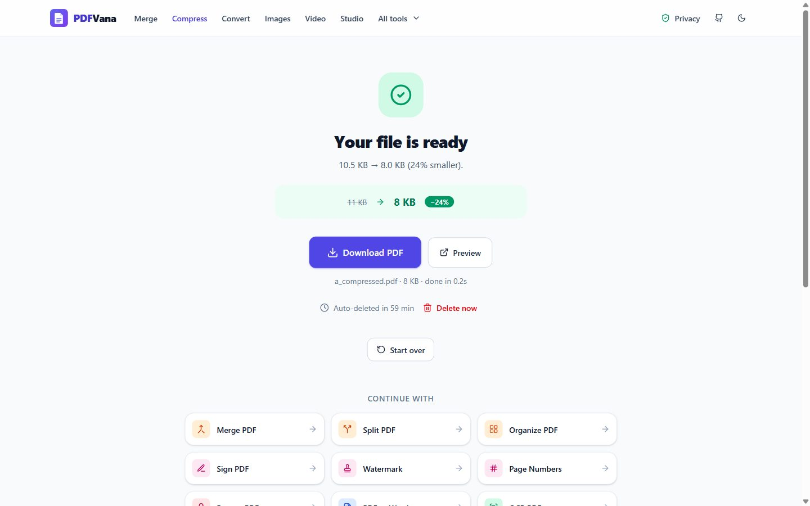

<div align="center">

<a href="https://github.com/divyakush2006/pdfvana"></a>

# PDFVana

### The free & open-source alternative to iLovePDF, Smallpdf and CloudConvert

**49 tools for PDFs, documents, images, audio and video — merge, split, compress, convert, OCR, sign and protect.**<br/>
No sign-up. No watermarks. No limits. Your files never leave your server.

[](LICENSE)
[](https://github.com/divyakush2006/pdfvana/actions/workflows/ci.yml)
[](https://github.com/divyakush2006/pdfvana/actions/workflows/codeql.yml)
[](https://securityscorecards.dev/viewer/?uri=github.com/divyakush2006/pdfvana)
[](https://github.com/divyakush2006/pdfvana/pkgs/container/pdfvana)
[](https://github.com/divyakush2006/pdfvana/stargazers)
[](https://github.com/divyakush2006/pdfvana/commits/main)
[](CONTRIBUTING.md)

[**Quick start**](#-quick-start) · [**Features**](#-features) · [**Screenshots**](#-screenshots) · [**Self-hosting**](#-deploy-to-production) · [**API**](#-rest-api) · [**FAQ**](#-faq) · [**Roadmap**](#-roadmap)


*Vana (वन) is Sanskrit for "forest" — a forest of free tools for every file.*

</div>

---

## ✨ Why PDFVana?

Online PDF services are convenient, but their free plans limit what you can do, push you towards a subscription, and require
uploading your documents to someone else's servers. PDFVana gives you the same everyday tools — and more — **free, open
source and on infrastructure you control**.

| | **PDFVana** | Typical freemium PDF sites |
|---|:---:|:---:|
| Price | **Free forever** | Free tier + paid plans |
| All tools available without an account | ✅ | Premium-only tools |
| Unlimited tasks, files and pages | ✅ (you set the limits) | Daily / size limits |
| Watermark-free output | ✅ | Varies |
| Custom workflows (merge → steps → export) | ✅ **Document Studio** | Premium |
| Images, audio, video & data conversion in the same app | ✅ | Separate sites |
| Open source & auditable | ✅ Apache-2.0 | ❌ |
| Self-hosted — documents never leave your network | ✅ | ❌ |
| REST API | ✅ free | Paid |
| Tracking / analytics | **None** | Common |

## ⚡ Quick start

**Option 1 — one command, no clone needed**

```bash
curl -fsSL https://raw.githubusercontent.com/divyakush2006/pdfvana/main/docker-compose.yml -o docker-compose.yml
docker compose up -d
```

**Option 2 — from source**

```bash
git clone https://github.com/divyakush2006/pdfvana.git && cd pdfvana
docker compose up -d --build
```

Open **http://localhost:8080** 🎉 — requires [Docker](https://docs.docker.com/get-docker/) and ~4 GB RAM.

## 🧰 Features

**49 tools · 175 input formats · 2,600+ format combinations · 83 one-click conversion pages** (e.g. `/pdf-to-docx`, `/docx-to-pdf`, `/heic-to-jpg`, `/mp4-to-mp3`).

| Category | What you can do |
|---|---|
| ⭐ **Workflows** | **Document Studio** — drop any mix of files, merge them, apply steps (compress, OCR, watermark, page numbers, header/footer, rotate, remove pages, grayscale, flatten, sanitize, password) and export to any format · **Universal Converter** — anything → anything |
| 📑 **Organize PDF** | Merge PDFs *and* Word/Excel/PowerPoint/images · Split · Remove pages · Extract pages · Visual organizer (drag, rotate, delete, insert blank pages) · Rotate |
| 🗜️ **Optimize PDF** | Compress (4 levels **or an exact target size in MB**) · Repair · OCR in 28 languages (incl. Hindi, Bengali, Tamil, Telugu) · PDF/A |
| 📥 **Convert to PDF** | Word, PowerPoint, Excel, Pages/Keynote/Numbers, ODF, images (incl. HEIC & SVG), web pages & HTML, Markdown, EPUB, e-mail (EML), code, CSV/JSON |
| 📤 **Convert from PDF** | Word (layout, tables & images) · editable PowerPoint · Excel/CSV/JSON · JPG/PNG/WebP/TIFF · SVG · Text/Markdown/HTML/EPUB/ODT/RTF |
| 🖼️ **Image tools** | Convert JPG, PNG, WebP, AVIF, HEIC, GIF, BMP, TIFF, ICO, SVG · Compress to an **exact KB size** · Resize/rotate/flip · PNG/JPG → SVG vectoriser · Favicon generator · Remove photo metadata (EXIF/GPS) · Website screenshot |
| 🎬 **Audio & video** | Convert MP4, MOV, MKV, WebM, AVI (trim, resize, mute) · MP3, WAV, FLAC, M4A, OGG, Opus · Video → GIF · Compress video |
| ✏️ **Edit PDF** | Watermark (text in any script or image, mosaic, behind content) · Page numbers · Header & footer · Sign (draw/type/upload, drag to place) · Crop (auto-trim) · Flatten · Metadata |
| 🔐 **Security** | Protect (AES-256 + permissions) · Unlock · **True redaction** with e-mail/phone/card/Aadhaar/PAN detection · Sanitize hidden data |
| 🧠 **Intelligence** | Compare documents side-by-side · PDF → Markdown for AI/LLM tools |

<details>
<summary><b>Every tool</b> (click to expand)</summary>

Document Studio · Universal Converter · Merge PDF · Split PDF · Remove Pages · Extract Pages · Organize PDF · Rotate PDF ·
Compress PDF · Repair PDF · OCR PDF · PDF to PDF/A · Word to PDF · PowerPoint to PDF · Excel to PDF · Image to PDF ·
HTML to PDF · Anything to PDF · CSV/Excel/JSON Converter · PDF to Word · PDF to PowerPoint · PDF to Excel · PDF to Image ·
PDF to Text · PDF to SVG · Image Converter · Compress Image · Resize & Rotate Image · Image to SVG · Favicon Generator ·
Remove Photo Metadata · Website Screenshot · Video Converter · Audio Converter · Video to GIF · Compress Video · Watermark ·
Page Numbers · Header & Footer · Sign PDF · Crop PDF · Flatten PDF · Edit Metadata · Protect PDF · Unlock PDF · Redact PDF ·
Sanitize PDF · Compare PDF · PDF to Markdown

</details>

## 📸 Screenshots

<table>
<tr>
<td width="50%"><p align="center"><b>Universal Converter</b> — only shows formats your files can become</p></td>
<td width="50%"><p align="center"><b>Results</b> — download, preview, delete now or continue with another tool</p></td>
</tr>
</table>

## 🌍 Deploy to production

A production stack with **automatic HTTPS** lives in [`deploy/`](deploy):

```bash
export DOMAIN=pdf.example.com          # DNS must point at your server
docker compose -f deploy/docker-compose.prod.yml up -d
```

Sizing, scaling and SEO tips: [docs/deployment.md](docs/deployment.md).

## ⚙️ Configuration

| Variable | Default | Description |
|---|---|---|
| `SITE_URL` | `http://localhost:8080` | Public URL — used for canonical links, sitemap and social cards |
| `JOB_TTL_SECONDS` | `3600` | Files are permanently deleted after this many seconds |
| `MAX_FILE_MB` / `MAX_TOTAL_MB` / `MAX_FILES` | `200` / `500` / `60` | Upload limits |
| `RATE_LIMIT_PER_MINUTE` | `40` | New jobs per client per minute |
| `API_RATE_LIMIT_PER_MINUTE` | `600` | All API requests per client per minute |
| `MAX_ACTIVE_JOBS_PER_CLIENT` | `4` | Jobs a single client may run at once |
| `JOB_TIMEOUT_SECONDS` / `JOB_MEMORY_MB` | `900` / `3072` | Hard time and memory limit per job |
| `TRUST_PROXY` | `false` | Trust `X-Forwarded-For` (enable only behind your own reverse proxy) |
| `WORKERS` | CPU count | Parallel jobs |

All settings: [`backend/app/config.py`](backend/app/config.py).

## 🔌 REST API

Every tool is available over HTTP — interactive docs at `/api/docs`.

```bash
curl -F tool=compress-pdf -F 'options={"level":"recommended"}' -F files=@report.pdf http://localhost:8080/api/jobs   # → {"id": "…"}
curl http://localhost:8080/api/jobs/<id>                 # poll until "status": "done"
curl -OJ http://localhost:8080/api/jobs/<id>/download     # get the result
```

Tool ids, options and examples: [docs/api.md](docs/api.md).

## 🛡️ Security

PDFVana treats every upload as hostile. Jobs run in isolated processes with memory and time limits; uploads are
content-verified; HTML is sanitised and Pandoc sandboxed; SSRF, XSS, CSRF and argument injection are blocked; containers
are read-only with all capabilities dropped. Every control has an automated attack test, and the code is scanned by
CodeQL, Trivy, pip-audit, npm audit and OpenSSF Scorecard.

→ [Security policy](SECURITY.md) · [Threat model](docs/security.md)

## 🏗️ Architecture

```
Browser (React · TypeScript · Tailwind · in-browser PDF previews)
   │  HTTPS: upload → job id → poll → download
   ▼
PDFVana engine (Python · FastAPI)                       Conversion service (internal only)
  • job queue · per-job process isolation      ───►     office documents & web pages → PDF
  • PDF engine: geometry, stamping, layout analysis,
    Word / PowerPoint / Excel / Markdown writers, redaction
  • image, audio/video & data converters · OCR · compression
  • server-rendered SEO pages · sitemap.xml
```

Details: [docs/architecture.md](docs/architecture.md).

## 🧪 Development

```bash
docker compose up -d converter
docker build --target engine -t pdfvana-engine .
docker run --rm -p 8080:8000 --network pdfvana_default -e CONVERTER_URL=http://converter:3000 \
  -v "$PWD/backend/app:/app/app" pdfvana-engine            # backend with your local code

cd frontend && npm install && npm run dev                   # UI with hot reload on :5173

docker build --target test -t pdfvana-test .                # 120+ unit, end-to-end & security tests
docker run --rm --network pdfvana_default -e BASE_URL=http://app:8000 pdfvana-test
```

Python dependencies are declared in `backend/requirements.in` and locked, with hashes, in `backend/requirements.txt`.
After changing a `.in` file, regenerate its lock with
`pip-compile --generate-hashes --allow-unsafe --strip-extras --no-emit-index-url backend/requirements.in`
(run it on Linux with Python 3.12, for example inside `python:3.12-slim-bookworm`).

## 🗺️ Roadmap

- [x] 49 tools across PDF, documents, images, audio, video and data
- [x] Document Studio workflows and Universal Converter
- [x] REST API, Docker images, one-command HTTPS deployment
- [x] Process isolation and full security test suite
- [ ] In-browser PDF editor (add/edit text, shapes, annotations)
- [ ] Fillable PDF forms (detect, create, fill)
- [ ] Interface translations (Hindi first, then 20+ languages)
- [ ] Installable app (PWA) and desktop builds
- [ ] Optional self-hosted AI: summarise, translate and chat with documents

Have an idea? [Open a feature request](https://github.com/divyakush2006/pdfvana/issues/new?template=feature_request.yml) or
join the [discussions](https://github.com/divyakush2006/pdfvana/discussions).

## ❓ FAQ

<details>
<summary><b>Is PDFVana a free alternative to iLovePDF?</b></summary>

Yes. PDFVana covers the everyday iLovePDF tools — merge, split, compress, PDF ↔ Word/PowerPoint/Excel/JPG, OCR, sign,
watermark, page numbers, protect, unlock, redact, compare, PDF/A — plus workflows, and it is free with no task limits,
watermarks or account.
</details>

<details>
<summary><b>Is it an open-source alternative to Smallpdf, Adobe Acrobat online or CloudConvert?</b></summary>

Yes. Beyond PDF tools it converts documents, images (including HEIC, AVIF, SVG and ICO), audio and video — 175 input
formats in one self-hosted app, under the Apache-2.0 licence.
</details>

<details>
<summary><b>Are my files safe and private?</b></summary>

When you self-host, files never leave your server. Inputs are deleted as soon as processing ends, results after one hour
(or instantly with "Delete now"), nothing survives a restart, and there is no tracking. See the
[threat model](docs/security.md).
</details>

<details>
<summary><b>Can I use it at work or in a commercial product?</b></summary>

Yes. Apache-2.0 allows commercial use, modification and redistribution. Keep the licence and notice files.
</details>

<details>
<summary><b>Does it work offline or in an air-gapped network?</b></summary>

Yes. Everything runs in two containers on your own hardware. Only "web page → PDF/screenshot" needs internet access to
reach the page you ask for.
</details>

<details>
<summary><b>How does it compare with other self-hosted PDF tools?</b></summary>

PDFVana has no paid tier and no telemetry, uses a permissive licence, and goes beyond PDFs with image, audio, video and
data conversion, a Universal Converter, Document Studio workflows and 83 SEO-ready conversion pages for public instances.
</details>

## 🤝 Contributing

Contributions of every size are welcome — bug reports, new tools, translations, docs and design. Start with
[CONTRIBUTING.md](CONTRIBUTING.md) and look for issues labelled
[`good first issue`](https://github.com/divyakush2006/pdfvana/labels/good%20first%20issue). Please report vulnerabilities
privately as described in [SECURITY.md](SECURITY.md).

## ⭐ Support the project

If PDFVana saves you time or money, **please [star the repository](https://github.com/divyakush2006/pdfvana/stargazers)** —
it is the single best way to help others discover a free alternative. Sharing it with your team or community helps too.

## 📄 License

[Apache License 2.0](LICENSE) · Copyright © 2026 Divyakush ([@divyakush2006](https://github.com/divyakush2006))
